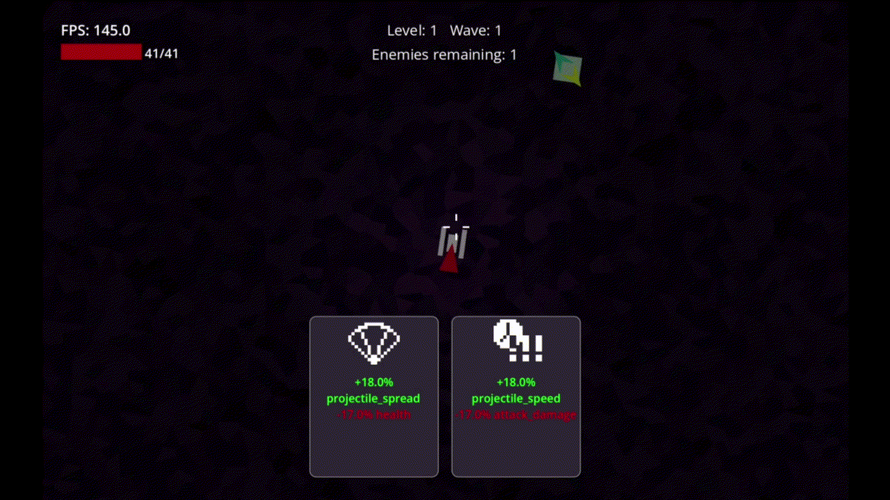
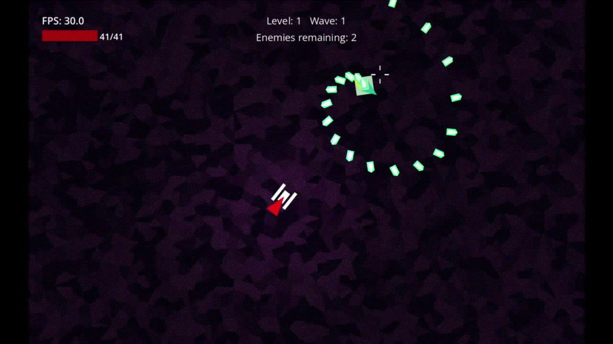

# Triangles

### Description  

A geometric 2D bullet‑hell shooter with deck‑building elements. Still in development!

Collect and combine **modifier cards** that boost movement, attack and defense stats or alter the rules of combat with property cards (e.g., piercing, homing, bounce, parry, rampage).  
Each level ends with a card‑selection screen where you can add, replace or merge cards for stat bonuses.

| 1 | 2 | 3 |
|---|---|---|
|  |  |  |

## Features  

- **Top down 2D Combat** with a clean vector artstyle 
- **Modifier cards** that change basic stats (movement speed, damage, health, etc.)
- **Property cards** that change gameplay rules (piercing, homing bullets, bounce, lifesteal, etc.).  
- **Card hand management**: Limited slots. Add or swap cards at the end of each level. Merge cards together.

## Controls  

| Action | Key |
|--------|-----|
| Look / Aim | Mouse movement |
| Move | `WASD` |
| Attack | Left Mouse |
| Swap weapon / card hand | Right Mouse |
| View cards (hold) | Tab |
| Special | Space |
| Menu | Esc |

## Planned Features  

- Active cards / special abilities (e.g. dash, homing, lifesteal).
- More interesting room layouts and procedural level scaling.
- Boss fights.
- Improved card UI.
- Fancier vector art

## Known Issues  

- Lag on first load of enemies, weapons, and scenes.
- Jittery camera movement.
